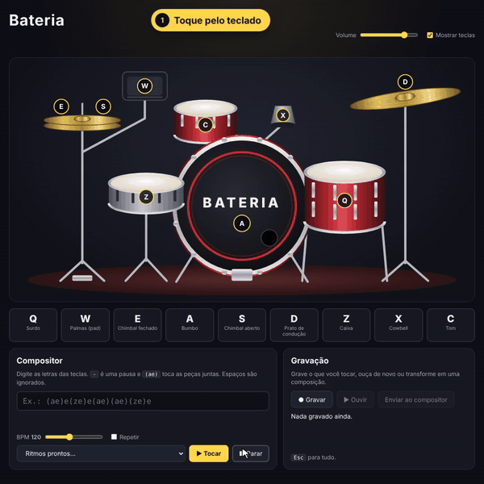

# 🥁 Bateria

Uma bateria que você toca no navegador, pelo teclado, com o mouse ou com o dedo no celular. Feita só com **HTML, CSS e JavaScript puro**, sem frameworks e sem bibliotecas.



## Como começou

Esse projeto nasceu como um exercício do curso da **B7Web**. A primeira versão tinha 9 quadrados na tela, e cada tecla tocava um som. Funcionava, mas era só isso.

Depois de um tempo, voltei nele com outra pergunta: *o que faria isso parecer um instrumento de verdade?* A partir daí, fui reescrevendo o projeto até chegar nesta versão.

## O que ele faz

- **Bateria desenhada em SVG**, sem nenhuma imagem: bumbo, caixa, tom, surdo, chimbal, prato de condução, cowbell e um pad eletrônico
- **Cada peça reage quando é tocada**: os tambores afundam, os pratos balançam e o chimbal abre e fecha
- **Teclado, mouse e toque**: dá pra tocar várias peças ao mesmo tempo, inclusive com vários dedos no celular
- **Sons simultâneos**: um som não corta o outro, então bumbo, chimbal e prato podem soar juntos
- **Chimbal realista**: tocar o chimbal fechado abafa o chimbal aberto, como numa bateria de verdade
- **Compositor**: você escreve um ritmo em texto e ele toca, com BPM ajustável, opção de repetir e ritmos prontos
- **Gravação**: grava o que você tocar, toca de novo e transforma a gravação numa composição encaixada no BPM
- **Volume** e opção de mostrar ou esconder as letras das teclas
- **Lembra suas preferências** (volume, BPM, última composição) entre uma visita e outra

## Teclas

| Tecla | Peça | Tecla | Peça | Tecla | Peça |
|:-----:|------|:-----:|------|:-----:|------|
| **Q** | Surdo | **W** | Palmas (pad) | **E** | Chimbal fechado |
| **A** | Bumbo | **S** | Chimbal aberto | **D** | Prato de condução |
| **Z** | Caixa | **X** | Cowbell | **C** | Tom |

`Esc` para tudo o que estiver tocando.

## Como escrever no compositor

Cada letra é uma batida, e cada batida dura meio tempo do BPM escolhido.

| Escrita | O que acontece |
|---------|----------------|
| `a` | toca a peça daquela tecla |
| `-` | pausa |
| `(ae)` | toca as peças juntas |
| espaço | é ignorado (serve só pra organizar) |

Exemplo de um rock básico: `(ae)e(ze)e(ae)(ae)(ze)e`

## Como rodar

Não precisa instalar nada. É só baixar a pasta e abrir o `index.html` no navegador.

Para o som responder mais rápido, abra com um servidor local, como a extensão **Live Server** do VS Code. Explico o motivo na parte de áudio, logo abaixo.

## Como eu fiz

### Áudio: Web Audio API com plano B
Na primeira versão, cada som era um elemento `<audio>`. O problema é que, ao tocar a mesma peça duas vezes rápido, o som reiniciava e cortava o anterior.

Agora os arquivos `.wav` são carregados com `fetch` e decodificados em buffers da **Web Audio API**. Cada batida cria uma fonte nova, então os sons se sobrepõem naturalmente e a latência é bem menor. Um `GainNode` controla o volume geral.

Só que o navegador bloqueia o `fetch` quando o arquivo é aberto direto do computador (`file://`). Para o projeto continuar funcionando nesse caso, criei um plano B: um conjunto de elementos `<audio>` reaproveitados em rodízio, que também permite sons sobrepostos.

O chimbal fechado guarda as fontes do chimbal aberto que ainda estão tocando e faz um fade rápido no ganho delas. É isso que imita o pé fechando o chimbal.

### Visual: SVG + animações CSS
A bateria é toda desenhada em SVG, com gradientes para o casco, as peles, o cromado e os pratos. Cada peça é um grupo com `data-key`, e o mesmo atributo liga a peça ao som e ao clique.

As animações são `@keyframes` em CSS: escala para os tambores, rotação para os pratos e deslocamento para o chimbal abrir e fechar. Para a animação reiniciar a cada batida, removo a classe, forço um reflow e adiciono a classe de novo.

### Compositor
O texto passa por um interpretador simples que transforma `(ae)e-z` em uma lista de passos: `[[a, e], [e], [], [z]]`.

A reprodução usa `setTimeout`, mas sempre calculando o horário em que o próximo passo deveria acontecer. Assim, pequenos atrasos não se acumulam e o tempo não "escorrega" com o loop ligado.

### Gravação com quantização
Cada batida é guardada com o tempo em que aconteceu (`performance.now()`). Para virar composição, divido esses tempos pela duração de um passo no BPM atual, arredondo e agrupo as batidas que caem no mesmo passo.

### Outros cuidados
- `keydown` ignorando a repetição automática da tecla e ignorando o que é digitado no campo do compositor
- `pointerdown` em vez de `click`, para responder na hora e aceitar vários dedos no celular
- Navegação com `Tab` e `Enter` nas peças, e respeito a `prefers-reduced-motion`
- Layout responsivo com CSS Grid
- Preferências salvas no `localStorage`

## Estrutura

```
bateria/
├── index.html   # estrutura da página e o desenho da bateria em SVG
├── style.css    # visual, animações e layout responsivo
├── script.js    # áudio, interação, compositor e gravação
└── sounds/      # os 9 sons em .wav (um por tecla)
```

Para trocar um som, basta substituir o arquivo `.wav` com o mesmo nome na pasta `sounds/`.

## Próximos passos

- Metrônomo
- Exportar a gravação como arquivo de áudio
- Mais kits de som para escolher

---

Projeto base: curso da [B7Web](https://b7web.com.br).
